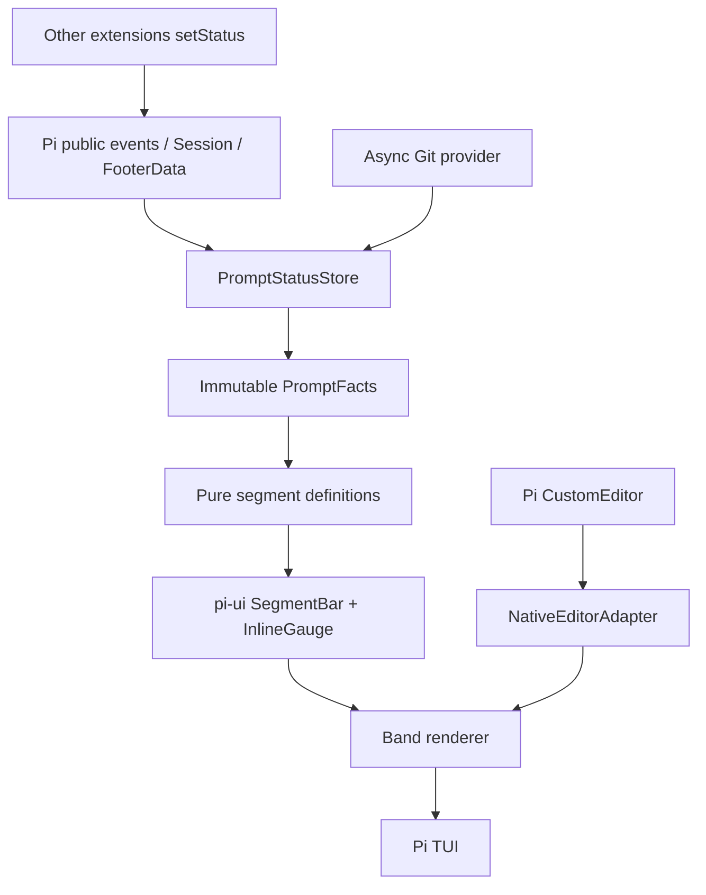

# Pi Prompt — 完整实施计划

- 版本：v1.3（第三轮审阅收敛版 + 复审修订 C1–C6，待动态门禁及审批）
- 日期：2026-11-25
- 项目：`@jackice/pi-prompt`（独立 Pi 扩展），依赖 `@jackice/pi-ui`
- 上游基线：用户提供的《Pi UI Kit — 完整实施计划》v1.2；其静态环境记录为 Pi 1.6.0、Node v25.9.0、Hashline 0.1.2、pi-ui 0.4.2（后两项来自用户本机审阅；实施时记录安装包指纹）。配套 pi-ui Plan v1.5 修订稿尚未生成（dotfiles 与 pi-ui 仓库当前均只有 v1.2，无 v1.5 文件）；生成、仓库落地及 commit 对账由 P1-03 仓库闭环项关闭，不宣称已交付。
- 参考：OMP Status Band、ComposerShape、StatusFacts、StatusTop；参考源码不是原生 Pi 可直接调用的 API。
- 状态：设计及任务已定义；未执行本机 PTY、编译、性能或兼容性测试。不得将本文视为已通过验收或无缺陷保证。

## 1. 目标与冻结决策

以 OMP `band` 为视觉基准：透明单行状态带，左侧品牌/主机/模型/路径/Git/Session，中央弹性 Context Gauge，右侧少量状态；下一行 `╰─ ` 后直接输入。正常输入不出现上下横线，长输入自然换行，保留原生光标、补全、历史、编辑、粘贴和快捷键。现有 Edit、TODO、Approval、Goal、Subagent 不迁入本扩展。

```text
φ > host > GPT-6.2 high > ~/dev/pi-ui > develop > 01a20dc6  2% ───────── 500K
╰─ ▏
```

以上为可选 replace 完整导航布局 fixture，不是默认 native 的整体高度。默认 Native Compact fixture（原生 footer 内容示意）：

```text
φ > GPT-6.2 high   2% ───────── 500K   41t/s
╰─ ▏
~/dev/pi-ui (develop) • session
↑18.2K ↓4.6K R219K CH92% 2%/500K (auto)    GPT-6.2 high
```

上图中 `41t/s`（token_rate）仅在可信 live 速率可用时出现；不可信时省略该段，不构成验收失败。

状态值仅为视觉 fixture。多行输入续行对齐正文；状态带固定一行；滚动提示最多额外一行（上下隐藏数合并），原生独立运行提示及补全不计入此预算。窄窗口按优先级紧凑/隐藏，不能挤压输入。默认透明、不依赖 Nerd Font；用户可选择 ASCII。保留原生重要运行提示，不承诺复制 OMP 所有像素或原生宿主行为。

### 1.1 范围

| 优先级 | 交付 |
|---|---|
| 必须 | Band、原生回退；Model/Thinking、Path、Git、Session、Context、扩展状态；状态布局、主题、光标/补全/鼠标/IME 兼容；迁移及回滚 |
| 必须（有可信数据才显示） | 输入输出 token、缓存读写、worktree、生成速率、运行耗时；未知值明确缺失 |
| 可选 | Borderless preset、时钟、底部辅助状态行、真实压缩阈值标记 |
| 不做 | Agent/Composer 输入引擎重写、Fork Pi、私有字段/Reflect/monkey patch、OMP JSX/Signal/TSP/native host、Bun/Rust binding、AI Vibes、Sticky Bash、Queue、Stash、Delayed Send、Welcome、网络 quota/PR 查询、永久授权 |

默认 band + 原生 footer（footerMode=native）；只有 §8.1 状态等价门禁及显式配置通过才允许 footerMode=replace。默认模式不安装自定义 footer，不获取 FooterDataProvider；扩展状态等由原生 footer 展示，band 不重复展示扩展状态；默认 Native Compact 仅 brand/model/context/token_rate；仅 Model/Thinking 与 Context Gauge 为有意重复，Path/Git/Session 及累计 usage 交原生 footer。可显式配置 Native Full 导航，但不属于默认视觉验收；未选择的 segment 不启动数据采集。native preset 为完整原生回退（不保留本扩展自定义 editor/footer），不是模拟原生样式。运行时 editor-only 回退称 native editor；replace 模式下不等于完整 native preset；若已替换 footer，完整 preset 切换须重启以恢复 footer；默认保留原生 footer 时，仅在 G0 验证 editor 所有权及草稿恢复后允许完整 native 热切换。Borderless 仅在 band 通过后按相同门禁交付。若旧 Powerline 的附加能力仍在使用，迁移前必须明确保留方案；不自动删除队列或修改现有配置。

## 2. 源码依据与边界

源码基线：OMP 远端 commit `6b96042dd77dbab2741299646e68c2fe227a1c4f` 已重新通过 GitHub commit API 和树查询核实（commit 日期 2026-11-24 UTC，tree `ac8b8b0a06611930a9917363af1fde974c0cd45a`）。用户本机 HEAD `3a8591a8a` 不含该对象及所述新路径，不能用它证明旧引用错误或声称本机已复现。P0 在独立 clone 中 fetch 固定 commit、`git cat-file -t`、`git ls-tree` 与 `git show SHA:path` 核对并记录 checkout；不改变用户工作树。若远端不可获取，记录替代 commit 和路径映射，经 Reviewer 确认再采用。Pi tag `v1.6.0` 已核对指向 `faac585884ae2c013a6b1400f3e9e77f10b34bac`；源码与用户提供 dist 行号并非同一行号体系。Powerline 参考 commit `eeacaa2ca5097328c548d85f8173f033f6752d81`。本次可交叉核对公开源码和用户报告，但无法读取用户 Mac 本机 dist 或执行真实 PTY。

### 2.1 审阅证据登记（静态与动态分开）

下列静态事实作为设计输入，G0 不再为其重复创建专门 PTY 探针；实施者仍需记录本机包指纹与源码片段，独立 Reviewer 签署后关闭 S01–S07。静态事实成立不等于动态门禁通过。

| ID | 静态事实与证据（用户本机 dist 行号 / 公开 tag 源码） | 状态 |
|---|---|---|
| S01 | FooterDataProvider 只读 getExtensionStatuses/getGitBranch/onBranchChange/getAvailableProviderCount；core/footer-data-provider.d.ts:32–63；公开 core/footer-data-provider.ts:384–387 | 静态已交叉核对 |
| S02 | ctx.getContextUsage() 可缺失，percent 可 null（本机 types.d.ts:203–210,268）；pi.getThinkingLevel() 属 ExtensionAPI 非 ctx（:1345）；公开 types.ts:381,1843 | API 位置已核对；null 语义据本机报告 |
| S03 | top/input/bottom/completion 顺序，autocompleteStartRow=visible+2；本机 editor.js:432/477/480/492；公开 editor.ts:569–639 | 静态已交叉核对 |
| S04 | paddingX=0 时保留 1 列给 caret；宿主安装和设置变更会 setPaddingX；本机 editor.js:403、interactive-mode.js:2393–2394；公开 editor.ts:533、interactive-mode.ts:3067–3068 | 静态已交叉核对 |
| S05 | 官方 border-status-editor.ts 的 EmptyFooter；lines[0] 与 lines[lines.length-1] 替换可能覆盖补全末行；公开示例:63,142–143 | 静态已交叉核对；不照搬示例 |
| S06 | editor getter 存在而 footer getter 不存在；自定义 editor 宿主不保证 dispose/invalidate，footer 有 dispose；setStatus 请求重绘、容器每帧 child.render；本机 interactive-mode.js:1933–1936,2120–2136 及 tui.js:112–118,153–155 | 本机报告与公开源码方向一致；宿主实际生命周期仍需动态验证：reload 时 footer dispose 是否先于 editor 替换，getEditorComponent() 是否先恢复 undefined；记录实际顺序，不以推断代替实测 |

| S07 | 原生 Footer 全文件 usage 累计与最新 assistant CH%；footer.ts:97–153；session-manager.ts:245–262,1487–1495,1528–1540：getEntries 为全文件浅拷贝，getBranch 为当前路径，getEntryCount 不在公开只读接口 | 静态已交叉核对；真实事件/落盘时序与统计对照仍待 G0-Data |

公开 tag 源码中 embedWorkingStatus / setWorkingStatusIndicator 协议（interactive-mode.ts:229–238）及原生状态容器路由也支持本次修订。不得将这些结论扩大为任意 Pi 版本的兼容保证。

| 源码 | 借鉴 | 不移植 |
|---|---|---|
| OMP `ui/styles/composer/shapes.ts` | band: top-band、无侧边/底边、gutter、零 padding | 8 种 shape 及全局注册表 |
| OMP `ui/styles/composer/frame.ts` | 先预算 gutter/内容宽度，再 paint field | native cell painter |
| OMP `ui/styles/status/top.ts` | 弹性 gauge、嵌入 labels、阈值避让 | OMP 主题及 compaction internals |
| OMP `ui/status/status-line.tsx` | 分段优先级、路径/标题缩短 | JSX runtime |
| OMP `modes/interactive/status-line.ts` | facts 快照、事件驱动、异步缓存、100ms 流式节流 | session 私有对象、网络 quota |
| Pi `packages/tui/src/components/editor.ts` | 原生布局、光标标记、滚动、补全及鼠标坐标 | 复制整个 Editor |
| Pi `packages/coding-agent/src/modes/interactive/components/custom-editor.ts` | 原生 app keybindings、顶部运行提示 | 私有成员 |
| Powerline `index.ts`, `segments.ts`, `README.md` | 用户既有配置、功能清单及 segment 经验 | Reflect fast editor、额外编辑器功能 |

## 3. 架构与代码所有权



- pi-ui 继续遵循 v1.5（继承 v1.4/v1.3/v1.2） 的依赖规则：仅纯渲染、主题及布局，不注册 editor/footer，不读 Session/Git、不持有 AgentSession、不控制权限。
- pi-prompt 拥有状态采集、配置、editor/footer 宿主、生命周期及迁移；无 Hashline/Workflow/Guardrails 实现依赖。
- 默认一个独立安装扩展；可与 pi-ui 同仓开发或新仓，G0 锁定；不要求 monorepo 重构。优先使用已有 package manager、strict TS、现有测试框架。
- 原生 Pi 继续拥有文本输入和发送行为；不得拦截 prompt submit、改写模型请求、注册模型工具或重写 Shell 执行。
- 扩展状态使用 Pi `setStatus` / FooterDataProvider；其他扩展不必改造。未证实的跨扩展结构化通道不作为必需依赖。

```text
pi-ui/src/components/
  status-line.ts           # 保留既有接口
  segment-bar.ts           # 新增：纯宽度布局
  separator.ts             # 新增：分隔符
  inline-gauge.ts          # 新增：弹性字符进度线
pi-prompt/
  src/index.ts             # 激活、命令、所有权
  src/config.ts            # schema/defaults/validation
  src/status/facts.ts      # 快照类型
  src/status/store.ts      # reducer + generation + subscribe
  src/status/scheduler.ts  # 合并刷新、可取消
  src/status/usage.ts      # session ledger / context
  src/status/git.ts        # async bounded provider
  src/segments.ts          # 小型纯函数 registry
  src/composer/shapes.ts   # band/native/(optional borderless)
  src/composer/frame.ts    # pure row composition + row map
  src/composer/native-editor.ts # SDK adapter
  src/integration/pi.ts    # public host/events, footer bridge
  tests/{unit,snapshots,pty,benchmarks}/
  examples/gallery.ts
  docs/{compatibility,footer-parity,migration,performance,implementation-status}.md
  package.json
  README.md
```

目录按真实消费者创建，不预建空抽象。pi-ui 对外 exports 使用公开路径；Pi SDK/TUI peer dependency 或 type-only imports，禁止 bundling 第二个运行时。直接复制第三方代码前审查许可证和归属；优先独立实现行为。

## 4. P0 — 真实兼容性探针（阻断门禁）

### P0-01 环境与源码

- [ ] 锁定 Pi/Node/OS、实际安装包和 commit、pi-ui commit/公开 exports、旧 Powerline 版本和真实配置（含 project override、启用功能及快捷键）。基线 pi-ui 0.4.2（现有 exports: `.`, `./diff`, `./views/edit`, `./views/todo`, `./views/approval`）；Hashline 0.1.2。记录 Ghostty/tmux 版本及字体环境；不得凭文件名推断实际版本。
- [ ] 核对 SDK 公开 CustomEditor、Component、EditorFactory、EditorTheme、鼠标事件、cursor marker、padding、protected hooks、set/getEditorComponent、setFooter、setWidget、getContextUsage、getThinkingLevel、事件及 footer provider 的真实签名、导出和可用模式。对 S01–S07 只补本机证据和 Reviewer 签署；静态关闭不代替动态探针。检查 native editor 的 render、handleMouse、focus、dispose 以及宿主恢复逻辑。
- [ ] 核对自定义 editor 激活后原生 working/compacting/retry/error 提示如何进入 editor；核对原生 status/footer 是否承担其他必要通知。
- [ ] 记录原生 `setFooter` factory 实际可读字段、刷新触发和生命周期；验证 `getExtensionStatuses`（若存在）、git branch、provider 订阅方式及 footer 返回零行时 factory 是否仍存活、状态变化是否可触发 redraw。不能假设 widget 能访问 footer provider。
- [ ] 核对现有 TODO/Goal/Subagent/Annotate/Guardrails 的 UI 安装入口、widget 顺序、modal、原生 editor 所有权及可能的 setStatus key。保存非敏感配置基线。

### P0-02 Editor 最小探针（首要可行性验证）

先执行静态状态带 PoC，不等待 P1 或真实 Git/Usage。优先使用目标版本若存在的公开 Chrome/无边框接口；Pi 1.6.0 已知路径为 CustomEditor + protected hooks + RowMapping。无安全路径则阻断；可提出上游 EditorChrome API（非现有 API），不 fork、不访问私有字段。

使用独立临时 PI_CODING_AGENT_DIR（以真实环境变量为准）、本地确定性 provider、无网络、无付费模型、无害 fixture。真实 Pi PTY 必须加载打包后的探针，不能只测试 mock。

- [ ] 继承公开 CustomEditor，调用 `super.render`，通过 Editor.renderTopBorder/renderBottomBorder（CustomEditor 覆写前者）两个 protected hook 标识原生顶部/底部行。证明只替换目标行、保留所有 autocomplete 行及 CURSOR_MARKER；验证用户内容碰巧等于标记时安全回退。
- [ ] 预留 prefix 列宽后让原生 editor 在剩余宽度布局；验证宿主 padding=0/1/2/3 与运行时设置变更、末尾光标、宽字符和自动换行。检查底边移除后 mouse y 映射、prefix x 映射及补全点击；原生滚动和鼠标选择不回归。
- [ ] 空草稿、长多行、滚动隐藏行、窄宽 0/1/2/10/40/80/120/240、连续 resize、completion 打开关闭均测试；无越界、无重复横线、无空白占位行。
- [ ] 测试中文 IME 候选框、组合字符、emoji、bracketed paste、附件和 slash/@ completion、历史、撤销、steering/follow-up、原生快捷键。PTY 自动测试与 Ghostty/tmux 手工 IME 测试分开记录。
- [ ] 真实 Approval custom UI 打开/关闭、Esc、abort、reload、Session 切换：草稿、光标、焦点、补全状态（若原生本就不保留则与 native A/B 相同）不回归。不得改变 Gate 安全策略。
- [ ] 原生运行状态（working、compacting、summarizing、retry、blocked）在 band 下仍准确可见；无法公开读取的状态不得猜测。首选 embedWorkingStatus=false 让宿主独立显示原生状态行且保留 band；若可靠支持嵌入状态，才选择 true 并保留 super.renderTopBorder 的原始状态内容。不得猜测 ANSI 文本；真实验证状态路由与布局。

### P0-03 Footer 数据与生命周期探针

#### 独立 G0-FooterBridge

先验证 native 路径：不调用 setFooter，逐字段对照原生 Footer，记录 `docs/footer-parity.md`；下列零行/Getter/跨宿主探针仅针对隔离的 replace 候选，不是默认 band 的前置条件。G0 验证可行性及原型字段等价/缺失审批；G4/G5 复核产品实现，隔离测试允许先于正式启用。replace 不在首版默认发布范围内；未通过时记录 BLOCKED 或 deferred，不影响 native 模式。

- [ ] native 断言（G0-FooterBridge native 分支的唯一证据）：同一 fixture 下全程未调用 `setFooter`，原生 footer 行数与内容与“未安装本扩展”基线逐行一致（含 extension statuses 行），结果记录到 `docs/footer-parity.md`。
- [ ] S05 已证明零行 Footer 是官方示例用法，无需单独证明返回 [] 合法；动态测试只验证本项目的跨宿主同步：首次安装、每帧 getter、同帧/下一帧更新、setStatus 修改/清除、branch change、resize、reload、切换 Session、dispose。
- [ ] 不依赖 invalidate；以实际 render 顺序为准。采用 P5-01 的 frame-local 读取路径；若本机公开 getter 无法直接从 editor 使用，则验证有界下一帧调度方案且不递归 render。连续静止 100 帧不得产生额外刷新，状态变化最多一次补偿 redraw；无可靠路径则阻断 replace。
- [ ] 旧 Powerline 与本扩展的活动 editor/footer 入口及可触发切换的路径硬性互斥；按 §9.1 区分仅安装、加载禁用、活动启用，不靠 load order。

- [ ] 验证 status 带和 editor 能共享单一 store。默认 native footer 不安装 bridge，扩展状态由原生 footer 保留。replace 路径才验证公开 provider 读取、状态等价及缺失清单；无可靠通道时阻断 replace 而不阻断默认 band。
- [ ] 验证 Session start/resume/switch/fork/tree/rewind/reload/shutdown 实际事件顺序；确认旧 context 不能在异步完成后写入新 Session。
- [ ] 验证 model/thinking/message/tool/compaction 事件以及 usage final/partial 的数据语义，捕获真实匿名 fixture；核对 context unknown、缓存统计、subscription cost、重放/分支。无生成速率可靠依据时隐藏。
- [ ] 按 §9.1 验证活动互斥、禁用但已加载时 toggle 风险、未知 owner 拒绝及隔离配置；不得声称运行时可检测所有 footer owner。
- [ ] 验证关闭/重载可安全恢复原生 editor/footer；不能在拥有者已更换时覆盖别的扩展。若缺少所有权检测，禁止运行时切换 footer，只提供重启式回滚。

### G0 门禁

| Gate | 证据 | 解锁 |
|---|---|---|
| G0-Base | 环境、包、pi-ui G1 兼容契约、公开类型、许可、可复现 fixture | P1 |
| G0-Editor | 真实 PTY 证明无边框、原生编辑/补全/鼠标/光标及状态提示可保留 | P3 |
| G0-Data | 来源矩阵、真实事件/usage/context fixture | P2 |
| G0-FooterBridge | 默认 native：原生 footer 未被替换且持续状态保留；replace：getter/零行宿主、无递归、状态增删、生命周期、footer-parity.md（无缺失则无需批准；有缺失须用户批准） | P5 对应模式；replace 单独解锁 |
| G0-Coexist | 原生回退、互斥、modal 与 Session 生命周期可行 | P5/P6 |

G0-Editor 失败：只可继续开发状态带纯组件或独立状态展示，不发布 band，不改核心/私有字段；列出阻断与可行上游公开 API 需求。G0-Data 失败：可完成纯 UI fixture，不宣称真实数据集成完成。G0-FooterBridge 按 native/replace 分别记录：默认 native 通过不代表 replace 通过；replace 未通过则禁止该模式，不阻断 native band。任何必需门禁缺证据标记 BLOCKED，而非默认为通过。独立 Reviewer 审核探针及证据。

## 5. P1 — pi-ui 共享组件

依赖 G0-Base 与 pi-ui v1.5 继承的 G1。仅增加有真实消费者的三个组件；不破坏现有 StatusLine/Panel API。渲染同步、纯函数，无 I/O/定时器/状态采集。

```ts
interface SegmentVariant { text: string; tone?: Tone }
interface SegmentSpec {
  id: string;
  side: 'left' | 'right';
  priority: number; // larger survives longer
  full: SegmentVariant;
  compact?: SegmentVariant;
  min?: SegmentVariant;
}
interface GaugeMarker { percent: number; glyph: string; tone: Tone }
interface InlineGaugeProps {
  percent?: number;
  label?: string;
  endLabel?: string;
  markers?: readonly GaugeMarker[];
  tone: Tone;
}
```

### P1-01 SegmentBar / Separator

- [ ] 接收有序左右分组，支持 `ascii`/`pipe`/`slash`/`dot`/`none`，可选 powerline；透明背景默认，使用现有 theme adapter。没有 Nerd Font 时用已验证的 ASCII glyph。
- [ ] 对每个 variant 用真实 visibleWidth；布局顺序：完整分段 → 路径/Session 紧凑 → 缩减 gauge 至标签最小宽 → 低优先级分段降级或隐藏 → 最终截断/空行。默认右侧非关键项先让出；相同 priority 按稳定配置顺序决胜。Model/Context 优先，工作/审批提示不被低优先级信息挤掉。
- [ ] 计算分隔符仅在实际相邻分段之间出现；宽度预算包含 prefix/padding/glyph。无负宽、孤立 separator 或多行溢出；width<=0 返回空。
- [ ] 输出纯布局结果（left/gauge/right、隐藏 ID、实际列宽），便于测试；不必引入通用 layout engine。

### P1-02 InlineGauge

- [ ] 中间弹性空间由 SegmentBar 分配；比例映射到字符列，颜色分段；真实百分比 >100 保留错误标签、画线长度 clamp；0% 不伪造使用量，未知显示 `?` 或容量，未知容量不画比例。
- [ ] 标签和阈值标记不重叠；按优先级放置，空间不足依次隐藏可选标记、容量标签，保留百分比短形式；不把 70/90 视觉警告当作压缩阈值。
- [ ] 标记仅来自真实 runtime config，不能取得则隐藏；控制字符、非有限数、负数、宽字符标记安全处理。
- [ ] 测试 0/1/2/10/40/80/120/240 列、0/0.1/2/70/90/100/110%、unknown、标签冲突、主题切换、ASCII。外部文本按 pi-ui v1.2 安全规则净化，保留本库生成的 ANSI，不允许 OSC/CSI 注入。

### P1-03 共享包发布契约

基线 pi-ui 0.4.2 无 SegmentBar。新增组件通过根 export `.` 导出，不删除或修改现有五个入口；计划首个兼容版本 0.5.0（用户第二轮审阅时 registry 仅见 0.0.0-stage/0.4.2，未占用；发布前再次核对并记录，若冲突须独立批准调整）。pi-prompt peer `@jackice/pi-ui: >=0.5.0 <0.6.0`，CI 至少验证最低版本及实际锁定版本；生产 lockfile 固定通过 G1-Prompt 的版本。0.x 不承诺跨 minor 兼容；0.4.2 仅作为回归基线，不可安装完整 pi-prompt。验证打包产物及 types、既有入口、ESM 解析；发布顺序 pi-ui → pi-prompt。未通过 gate 不发布依赖方。

- [ ] P1-03 仓库闭环：将两份完整修订稿分别落到 pi-ui 与 pi-prompt 实际仓库的 `docs/pi-ui-implementation-plan.md` / `docs/pi-prompt-implementation-plan.md`（同仓则使用两个独立路径）；确认文档版本 v1.5/v1.3、共享 API/exports/peer 范围和 §11 delta 一致。记录实际 commit SHA、路径、`git show` 证据到 implementation-status.md，独立 Reviewer 签署。文件已生成不等于仓库已提交；未落地则 G1-Prompt 不关闭，不阻断原三场景。

G1-Prompt：纯组件测试、快照、实际 pi-ui 构建产物导入通过；现有 Edit/TODO/Approval 测试无回归。组件合并前冻结公开接口并独立审查。

## 6. P2 — 状态数据、事件与缓存

依赖 G0-Data；纯 reducer 可与 P1 并行。单 Session store、不可变 snapshot、单写者，不引入响应式框架或全局 event bus。

```ts
interface PromptFacts {
  generation: number; revision: number;
  session: { id?: string; name?: string; cwd: string };
  model?: { id: string; name?: string; provider?: string; thinking?: string };
  git?: { branch?: string; worktree?: string; staged?: number;
    unstaged?: number; untracked?: number; stale: boolean };
  usage?: { input?: number; output?: number; cacheRead?: number;
    cacheWrite?: number; totalTokens?: number; costTotal?: number;
    costFromProvider?: boolean; scope: 'session_file' };
  context?: { used?: number; capacity?: number; percent?: number;
    quality: 'reported' | 'estimated' | 'unknown' };
  runtime: { phase: 'idle' | 'running' | 'compacting' | 'retry' | 'blocked' | 'unknown';
    durationMs?: number; tokensPerSecond?: number };
  extensionStatuses: Readonly<Record<string, string>>; // native 恒为空；replace 仅公开 provider 的 frame-local 合成值
}
```

`extensionStatuses` 在 native 模式始终为空，不另寻采集通道；replace 的 getter 值只在当前帧派生只读 facts，不写入业务 store。`usage` 为持久化 session_file 累计；实时 request 数据独立用于 rate，不复用该字段。`totalTokens` 直接取公开 `usage.totalTokens`（`packages/ai/src/types.ts:480`），缺失时才退回 input+output+cacheRead+cacheWrite；禁止再加 `reasoning`（output 子集）与 `cacheWrite1h`（cacheWrite 子集）（types.ts:472–479）。`costTotal`/`costFromProvider` 语义见 P2-02。

### P2-01 数据来源矩阵（以 G0 真实签名为准）

| 数据 | 首选来源 | 更新与降级 |
|---|---|---|
| model / thinking | ctx.model / pi.getThinkingLevel、选择事件 | 初始及改变；未知省略 |
| cwd / session | 当前 context / sessionManager 公开 API | start/switch/fork/tree；不读其他 session 文件 |
| Git | async git provider；replace 可补充公开 footer branch | 初始、工作区变化、手动刷新；旧值标 stale |
| Context | ctx.getContextUsage() | 消息/压缩/模型切换后；未知不猜测 |
| token/cache | 公开 sessionManager.getEntries() 的全文件 usage entries（五类见 P2-02）；事件仅触发刷新 | 重建+增量；partial 不重复计数 |
| rate/time | `message_update` 的 `partial.usage` 累计 output tokens + monotonic timestamps | 冻结为“当前响应累计 output tokens ÷ 单调时长”（live），不是末次响应平均；Anthropic 路径在 message_start/message_delta 期间即更新 usage（`ai/api/anthropic-messages.ts:966–976,1098–1125`），其他 provider 由 G0-Data 逐个取证；无 live 依据则隐藏，不能用字符数冒充 |
| extensions | footer data provider 的公开状态读接口 | 默认由原生 footer 展示；replace 每帧读取公开 getter，按 §9 生命周期处理；不依赖 invalidate，不解析业务内部状态 |
| workflow/goal/subagent | 已有 setStatus keys | native 由原生 footer；仅 replace 配置映射；缺失隐藏；不强制修改其他扩展 |
| compaction marks | 已验证真实配置 | 取不到则隐藏 |

### P2-02 Session usage ledger

- [ ] 冻结 `session_file` 口径：当前 Session 文件所有分支的持久化 entries，与 Pi v1.6.0 原生 Footer 相同；不是账户累计，也不是当前有效分支。Context 独立使用 ctx.getContextUsage()，不可由累计 usage 推算。token_total 取公开 `usage.totalTokens`（缺失才按 input+output+cacheRead+cacheWrite 求和），不得加入 `reasoning`/`cacheWrite1h` 等子集字段。
- [ ] 统计器使用公开 `sessionManager.getEntries()`，按原生 footer.ts:120–139 的互斥分支逐条处理：`usage`；`message/assistant`；`message/toolResult` 且有 usage；`branch_summary` 且有 usage；`compaction` 且有 usage。与原生 `addUsageToTotals` 的字段、单位及缺失处理逐项对照；不能把不同 entry 类型仅因数值相同而去重。同一持久化 entry 仅计一次，禁止同时把 final event 与其落盘 entry 相加。CH% 如后续实现，按全文件最后一条 assistant entry 的 cacheRead/(input+cacheRead+cacheWrite)，分母为零则 unknown，不用累计比率替代；当前无独立 ID，仍为 replace 候选缺失项。
- [ ] 正确性优先：激活、resume、fork、新文件、已验证落盘完成事件、compaction/summary/tool usage 及手动刷新后，在 render 外合并重建。G0 捕获五类 entry 的实际提交顺序与可观察事件；若事件早于落盘，使用已验证的后续事件或有界一次性补偿读取；不能证明最新值则标 stale/unknown，阻断该字段等价，不无限轮询。partial 仅用于临时 rate，不入累计。重复事件、乱序、失败、取消、重试均以实际持久化 entries 为权威。
- [ ] 同一文件 tree/rewind/切分支且未新增 usage 时累计不变；若追加 summary/usage 则按新增真实记录变化。fork 新文件或 session switch 按新文件实际 entries 重建；不得继承旧 ledger。测试共同历史 10K、A 20K、B 15K：全文件 45K、B 分支 25K，band 应为 45K；追加有 usage 的 summary 后只增加实际记录对应值。另测仅 toolResult/usage/compaction/branch_summary、重复通知、无 usage、无持久化 Session、fork 复制历史及多 provider。Context 随 leaf/压缩变化且可 unknown。
- [ ] 缓存参考原生 footer.ts:97–118 的 session/sessionId/leafId/entryCount/limitsModel 失效策略，但公开 ReadonlySessionManager 不含 getEntryCount，routedModel 也不公开；禁止使用二者或 private session。初版 UsageCacheKey=(generation, sessionId, usageRevision)，ContextCacheKey=(generation, sessionId, leafId, modelRevision, contextRevision)；revision 由已验证事件及快照更新维护，不假定 leaf 变化等于新增 usage。默认只对可见/配置需要的字段计算；同一文件切分支可复用累计仅当能证明没有新 entry，否则重建。增量优化仅在全文件 oracle A/B 通过且身份及 append-only 契约明确后启用；可用公开 getEntries 的稳定身份/顺序验证，失败即重建；不在 render 扫描、不使用无界缓存。
- [ ] cost 语义按公开 `usage.cost.total` 与 `cost.totalFromProvider` 区分：`totalFromProvider === true` 才是 provider 报告的计费成本，否则为目录估算；聚合时仅当全部分项均为 provider 报告，合计才可标为计费（对照 `core/usage-totals.ts:42–47,56–63` 的 `combineUsage` 策略）。默认 native band 不显示 cost；replace 必须以原生同口径累计（`cost.total` 求和）实现，并在 band 与 `/prompt-ui status` 区分计费/估算；Plus OAuth / 订阅的 API 等价估算不得称为账单，(sub) 无可信来源则列候选缺失。未知费用不造零，不请求外部 quota 或汇率。
- [ ] G0/G2 对原生 Footer 全字段 oracle 进行宽终端及原始值对照，不能只比较格式化字符串；记录 fixture、entry 类型、范围、值及差异到 footer-parity.md。任一 scope、entry coverage 或数值差异登记 usage scope/coverage 差异，未修复或未经用户逐项批准则阻断 replace。native band 如主动展示 usage 也必须准确标注 scope；不因原生 footer 保留而允许错误统计。
- [ ] 限制缓存生命周期；全文件重建耗时单列，不新增 Session 业务持久化。

### P2-02a Powerline 经验与 RuntimeStatus

- [ ] 对固定 Powerline commit 的 token-stats.ts、context-usage.ts、git-status.ts、render-scheduler.ts、editor-composition.ts、editor-performance.ts、lifecycle.ts 及相关测试建立参考矩阵：数据语义、分支/压缩、缓存、回归 fixture；不复制 Reflect fast path 或非本项目功能。只借鉴 footerDataRef 的公开 factory 捕获模式，不借鉴 index.ts:1348–1396 installFooterStatusRepaintHook 对 provider 方法的改写；宿主 setExtensionStatus 自身 requestRender（Pi interactive-mode.ts:2500–2503）。
- [ ] RuntimeStatus 只映射真实公开事件，沿用 PromptFacts.runtime.phase；running/compacting/retry/blocked/idle/unknown，summarizing/error 等仅在实际证据支持时增加映射，不新建 Agent 状态机。原生独立指示器优先，Segment 不重复输出同一状态。不能用错误/取消事件猜测下一阶段。

### P2-03 Git provider

- [ ] 只在 Git segment 启用时启动，异步 spawn/execFile，不用 shell 拼接 cwd；限制输出、超时（建议 2s）、最多 1 个运行子进程 + 1 次合并 pending 刷新，AbortSignal/kill 清理。
- [ ] 使用 `git --no-optional-locks status --porcelain=v2 -z --branch`（实际版本验证）；正确解析 staged/unstaged/untracked、rename 双记录、冲突、detached HEAD、unborn、非 repo。计数定义为路径记录数，一条可同时 staged 与 unstaged；不冒充行数。worktree 用公开 Git 命令按需查询，不读私有 Agent 状态。
- [ ] 事件驱动失效：session/cwd 变化、已知工具结束（包括 hashline、write、edit、bash）、手动 refresh；5s TTL 仅作为按需刷新限频，不在 render 中触发 I/O。不依赖工具名覆盖所有外部修改；外部修改在下一刷新事件/手动 refresh 后更新，明确 stale 语义。默认无轮询。`git.refresh` 冻结为 event（默认）、manual（只初始及显式刷新）、poll（显式选择，默认间隔 10000ms，最小 5000ms）；poll 仅 TUI 且 Git segment 配置启用时运行，避免重复 pending，退出/切换/关闭即取消；记录外部变更最迟下次成功查询才可见。TTL 限频不阻断最终刷新，手动刷新可跳过 TTL 但不得突破并发上限。
- [ ] generation + cwd + request id 校验迟到结果；旧 Session、超时、卸载不得发布结果。非 repo 隐藏；错误不弹窗刷屏，不阻塞编辑。

### P2-04 scheduler 与生命周期

- [ ] 状态变更合并，流式最多 10Hz；用户按键和原生编辑重绘不节流。紧急 model/context/错误状态合并但不丢末次更新。单次 trailing timer 可取消，默认空闲无 interval；可选时钟/Git poll 仅显式启用时由扩展生命周期 owner 管理，退出清理；BandEditor 禁止持有这些资源。
- [ ] generation 在 Session/branch/cwd 失效及卸载时递增；异步操作捕获 generation，发布前核对；unsubscribe/timer/child process 均有唯一 owner。footer factory/Editor 重建不得重复启动 provider。
- [ ] `render()` 只读快照、同步渲染，不扫描 Session、不访问 Git/网络、不注册事件。数据错误仅降级相关 segment。
- [ ] 测试重复事件、事件乱序、流式高频、abort、reload、主题变更、100 次切 Session、慢 Git、外部修改、无 Git、无 UI。

G2-Prompt：真实 fixture 来源矩阵完整、全文件累计与原生 oracle 等价、无重复计数或跨 Session 污染，Context 独立按当前分支，未知值诚实降级，事件驱动重绘通过。独立 Reviewer 核对 usage 算法及生命周期。

## 7. P3 — Native Editor Adapter 与 Band Shape

依赖 G0-Editor、G1-Prompt；状态数据未就绪可先用 fixture，真实接入需 G2-Prompt。实现路径只允许使用公开 CustomEditor 及已验证的 protected hooks，不复制原生 render 算法，不写 private 字段。

### P3-01 Shape 与布局契约

```ts
type PromptShapeId = 'band' | 'native' | 'borderless';
interface PromptShape {
  id: PromptShapeId;
  statusPlacement: 'above' | 'below' | 'none';
  firstPrefix: string;
  continuationPrefix: string;
  transparent: boolean;
}
interface RowMapping {
  kind: 'status' | 'input' | 'completion' | 'scroll';
  nativeY?: number;
  xOffset?: number;
  nativeWidth?: number;
}
interface FrameResult {
  rows: readonly string[];
  mapping: readonly RowMapping[];
}
```

- [ ] band：顶部状态行取代原生 top border，输入行无底边；第一可见输入行加 `╰─ `（ASCII 为 `> `），续行补等宽空白；顶部 band 固定 1 行，若存在上下隐藏行则在 input 后、completion 前增加至多 1 行合并显示 `↑N ↓M`（ASCII `up:N down:M`），窄宽不足则按下述确定性判定表原生回退；不得丢失隐藏数。补全保留全部原生行。
- [ ] native：保持原生 editor/footer 不变；不安装自定义 shape。borderless 可选，无上下横线、`❯ `，状态栏下方；所有映射和回退门禁同 band，未通过则不发布该 preset。
- [ ] 使用 ANSI-aware display width；前缀占宽从 native render width 扣除，不能先全宽布局再强行裁剪。明确选择尊重宿主 padding，而非 override 忽略设置。W=宿主列宽，p=前缀实际列宽，N=W-p 是传给 super.render 的外部宽度；a=min(getPaddingX(), max(0,floor((N-1)/2))) 是原生实际 padding；C=max(1,N-2a)，L=max(1,C-(a===0?1:0)) 为文本布局宽。原生会自行扣除 2a，不能再从 super.render 参数扣一次，否则重复扣减。保留原生左右 padding 和光标溢入右 padding 的语义；所有 input/completion 行加同宽 gutter（completion 用空格），最终宽 <=W。正文起点 p+a，鼠标转发 x'=x-p，由原生再扣 a。宿主 padding 0–3 可能安装后或运行中变化，每帧读取公开 getPaddingX，禁止假设 0；窄宽按下表选择 prefix，无法保留光标列则 identity fallback。
- [ ] 状态带和 editor 的行数不得因其他 segment 换行增加；保留 Pi 自己的输入高度预算。小窗口以可编辑性为先。禁止直接写终端 cursor 定位 escape。


#### P3-01a 确定性宽度与行数矩阵

W 为宿主整数列宽；q 为公开 getPaddingX() 的设置值 0–3；候选前缀依次为配置的合法前缀（默认 Unicode `╰─ `，ASCII `> `）、单列 `>`、空字符串，去重；p 为候选真实显示宽度。逐个计算 N=W-p、a=min(q,max(0,floor((N-1)/2)))、C=N-2a、L=C-(a===0?1:0)。仅当 N>=2 且 L>=2 才接受候选；否则尝试下一候选。原生最小宽度行为不由本扩展改变。W<2 或无候选时直接 identity fallback。先确定候选再执行一次 capture；若 capture 或最终宽度/scroll 校验失败，立即 full-width identity fallback，不反复试探或裁剪 native 行。

| 条件（按顺序判定） | p/a 与 frame | 行数与交互 |
|---|---|---|
| W 非有限、非整数或 W<2；无合法候选 | 不构造 band；交原生宿主合法宽度契约 | identity；不适用 band 行数断言 |
| 正常候选 N>=2、L>=2，hiddenTop=hiddenBottom=0 | 使用实际 p 与 a | 1 status + I input + 0 scroll + K completion；completion nativeY=newY+1 |
| 同上，有任一隐藏数且完整紧凑提示可放入 W 列 | p 可为 0；a 仍由 N 算出 | 1 status + I input + 1 scroll + K completion；completion nativeY=newY |
| 有隐藏数但提示超宽，或原生行/marker/cursor/map 校验失败 | 清 capture，重新 full-width native render | identity；不得截断隐藏计数或补全 |
| p=0 且其余条件通过 | 无首行 glyph、无 continuation gutter，正文起点 a | 同一行数规则；completion 偏移只取决于 scroll 是否存在，非 p |

I>=1、K>=0 取原生真实捕获。每个 input/completion 行 x'=x-p，原生再扣 a；status/scroll 不转发为输入。前缀区点击首版仅聚焦（通过公开宿主鼠标契约验证；不能安全实现则不转发）。scroll 文本固定 Unicode `↑N ↓M` / ASCII `up:N down:M`（含 0 值亦显示）；不添加 hint 行。原生独立状态容器和 footer 不计 band 预算。宽度降级及 identity 不得改变提交文本；恢复宽度后重新计算 band。

自动生成测试笛卡尔积 W={1,2,3,4,5,6,7,8,9,10,40,80,120,240} × q={0,1,2,3} × prefix={Unicode,ASCII,合法自定义} × hidden={(0,0),(1,0),(0,1),(1,1),(12345,67890)} × completion={0,1,5}；断言所选 p/a、I/K、行数、map 与回退结果。额外测 W=0 的纯布局保护及所有候选的边界 N/L；真实 PTY 覆盖可实际设置的宽度/padding 及每类分支代表用例，不要求终端模拟不可实现尺寸。G0 验证前缀焦点、真实 scroll 与补全组合，不能仅用合成 fixture 代替。

### P3-02 NativeEditorAdapter：明确边框定位及失败策略

BandEditor 只拥有同步 capture、最后一帧映射、纯布局缓存及读取当前 facts 的引用；不得持有定时器、订阅、子进程、跨 Session 回调或依赖宿主调用 editor.dispose/invalidate。Pi 1.6.0 宿主 clear editor 容器不等于 dispose。所有资源属于扩展 Session lifecycle owner，依已验证 shutdown/reload/reset 事件清理；每帧 generation 校验避免已脱离 editor 使用旧快照。

固定 Pi v1.6.0 代码显示：top border → visible input rows → bottom border → autocomplete rows；`handleMouse` 假定原生 top border 占 1 行，autocomplete 起点为 visible input rows + 2。当前安装版本的实际契约以 G0 为准。

建议实施如下薄适配器（伪代码，不是已通过编译的 SDK 代码）：

```ts
class BandEditor extends CustomEditor {
  // 仅本类自有的 render capture 与 row map；禁止访问原生 private state。
  protected override renderTopBorder(w: number, hidden: number): string {
    const original = super.renderTopBorder(w, hidden);
    return this.captureBoundary('top', original, hidden);
  }
  protected override renderBottomBorder(w: number, hidden: number): string {
    const original = super.renderBottomBorder(w, hidden);
    return this.captureBoundary('bottom', original, hidden);
  }
  override render(width: number): string[] {
    // 1. 根据 shape、宿主宽度和真实 prefix 宽度计算 nativeWidth。
    // 2. 在一次同步 capture scope 中调用 super.render(nativeWidth)。
    // 3. 验证边界调用次数、标记唯一性、索引顺序、所有行宽。
    // 4. 用真实状态带替换 top；给 input 加前缀；移除 bottom；
    //    保留 completion；如有隐藏行，展示紧凑 scroll indicator。
    // 5. 构建新行到原生行的映射，并原子发布最后成功 frame。
    // 6. 任一验证失败，清除 capture/map，super.render(width)
    //    原样返回，确保绝不向 TUI 泄漏内部标记。
    return this.renderVerifiedFrame(width);
  }
}
```

- [ ] capture 仅在一次同步 `super.render` 调用内启用；`finally` 清理。每次生成不会被解释为终端指令的临时标记，并保存对应的原始边框和隐藏行数；不使用用户文本、颜色或 `──` 正则判断边界。仅接受 top/bottom 各一次、完整行标记唯一、top 在首行、bottom 在其后、至少一条输入行的已验证结构。碰撞、额外边界调用、异常一律 fallback；输出前验证没有任何内部标记残留。
- [ ] 不使用 `slice(1,-1)` 或 `filter(line.includes('─'))`；否则补全、用户代码行、滚动状态会被错误处理。
- [ ] fallback 重新调用原生 render 的实际 full width，捕获关闭，保存 identity mapping；不能直接输出以窄宽生成的 native frame。避免异常反复触发重绘，记录一次非敏感诊断；若原生自身异常交由原生宿主处理，不吞掉系统错误。
- [ ] `CURSOR_MARKER` 及 native 输入行 ANSI 原样保留，不走用于外部文本的 sanitize；本扩展只对外部状态数据进行净化，不能清除原生光标定位序列。前缀插入不改变原始 prompt 文本、caret logical column 或模型输入。
- [ ] 不对原生输入行做二次换行/截断；若宽度不合规应回退，而不是裁掉光标或末尾字符。若需要右侧提示，优先放状态带；不得覆盖草稿、补全或 cursor。不增加 thinking hint 行或输入内提示；Thinking Level 仅由 Model Segment/原生 footer 展示。

### P3-03 鼠标、滚动与补全映射

设终端宽 W，prefix p，实际原生渲染宽 N=W-p（内部 padding 及 caret 预算见 P3-01），native top index=0，bottom index=B。普通 band frame：status=0；输入行 nativeY=1..B-1 保持 y，x 转为 x-p；completion 行的 nativeY 比新 y 多 1，x 按实际添加的左侧留白计算。若额外 scroll 行存在，不使用固定偏移，按每帧 RowMapping 显式转换。

- [ ] 覆盖公开 `handleMouse`（仅当 G0 验证可用）。使用最后成功 frame 的行映射和 nativeWidth，转发 native input/completion 事件给 `super.handleMouse`。同时按真实事件契约映射 width、height、x、y；height 若影响补全/选择，使用 native 原始行数。不能将 status/scroll 行当成输入行。
- [ ] 对点击 prefix，明确行为为仅聚焦且不移动正文光标（G0 验证公开契约，无法安全聚焦则不转发）；其他未映射区域不伪造输入事件。拖选、鼠标滚轮、press/release 依照原生返回语义，不劫持全屏选择。resize 后 stale mapping 禁止转发不可信坐标，等待新 frame 或按宿主约定安全降级。
- [ ] native fallback identity mapping 保留原生所有交互；旧 map 在每次 render 开始、失焦/卸载时失效，只有成功 frame 原子提交。
- [ ] 补全内容和 caret marker 不重建；completion 的所有行在原始顺序追加，支持键盘和鼠标选择。输入区缩进与补全对齐优先复用原生宽度预算。
- [ ] 每种 shape 用真实 PTY/鼠标事件验证：首行、换行、末端光标、长草稿滚动、点击补全首末项、终端 resize、选择复制。不能仅比较字符串 snapshot。

### P3-04 原生运行状态与焦点

- [ ] 保存 super.renderTopBorder 的真实输出与隐藏行信息，避免丢失原生 working/compaction/retry 提示；G0 选择公开状态来源或保留原生状态行的明确降级策略。不通过解析任意颜色字符串猜测运行阶段。
- [ ] 默认选择 `embedWorkingStatus: false`（按实际公开类型/构造参数实现），由 Pi statusContainer 独立显示运行提示，band 保持不变。可选嵌入模式只有 G0 证明安全才启用：复用 super.renderTopBorder 的原始行，若无法兼容布局则切回宿主独立状态行；不得为隐藏横线丢失提示。独立状态容器不计 band 行数；记录实际支持矩阵。
- [ ] 不替换 handleInput（确需覆盖时只能完全委托 super，不添加新的业务行为）；不得拦截 Enter/Esc/Tab、paste 或发送语义。保留公开焦点契约；不依赖 editor dispose，资源归扩展生命周期。
- [ ] Approval/Ask/Annotate 占据 editor slot 时由 Pi 原生管理。pi-prompt 不主动关闭 modal、不抢焦点、不重设草稿；恢复后重新读取快照；如果宿主没有恢复草稿则阻断发布，不能通过重放用户 prompt 规避。

G3-Prompt：普通 band 无上下边框/空白占位，A/B 原生输入行为等价，所有布局及鼠标映射通过，兼容失败安全回退。独立 Reviewer 检查光标与鼠标坐标、边界捕获和宿主公开接口。

## 8. P4 — 状态带与 Segment 产品化

依赖 G1-Prompt、G2-Prompt；与 P3 可在 frame 契约冻结后并行。默认一行；右侧时间、cache、hostname 等低优先级信息可隐藏。所有数字需要明确 scope、来源及格式。

冻结 Segment ID（priority 越大越保留；同级按配置顺序；context 是 gauge 专用 ID，不重复配置到左右组）。native 默认仅四项，replace 默认候选须通过 §8.1，不能以表中的 on 代替等价验证。

| ID | priority | Native Compact 默认 | Replace 候选默认 | 缺失/紧凑策略 |
|---|---:|---|---|---|
| brand | 20 | on | on | 隐藏 |
| hostname | 10 | off | off | 短名/隐藏 |
| model | 100 | on | on | 短 ID / unknown；含 thinking/provider |
| path | 80 | off | on | home→basename→中间省略 |
| git | 75 | off | on | branch+dirty→branch；非 repo 隐藏 |
| session | 30 | off | on | title/短 ID；名称完整可查看 |
| context | 100 | on | on | gauge→pct/capacity→pct；unknown=? |
| workflow | 60 | footer | 映射有值 | 紧凑/隐藏 |
| subagents | 65 | footer | 映射有值 | 紧凑/隐藏 |
| extension_statuses | 40 | footer | on | 未映射 key 聚合，完整可查看 |
| token_in | 35 | off | on | 紧凑/未知隐藏 |
| token_out | 35 | off | on | 紧凑/未知隐藏 |
| token_total | 35 | off | off | 取 `usage.totalTokens`；缺失才四项求和；不加子集字段 |
| cache_read | 35 | off | on | 紧凑/未知隐藏 |
| cache_write | 30 | off | on | 紧凑/未知隐藏 |
| token_rate | 50 | on（可信 live 时） | on（可信 live 时） | 定义见 P2-01；不可信隐藏 |
| elapsed | 45 | off | off | 紧凑/隐藏 |
| cost | 15 | off | on（可得时） | 明确估算/隐藏 |
| time | 10 | off | off | 隐藏 |

`token/cache/rate` 不是配置 ID；不支持未定义别名。运行/审批提示由原生宿主保留，不参与普通 segment 丢弃。配置中重复或未知 ID 报一次诊断并使用安全默认；专用映射已消费的 status key 从 aggregate 排除。

### 8.1 原生 Footer 状态等价与产品默认（M1 / R1 / R2）

证据：Pi v1.6.0 `footer.ts:157–302` 使用 session.state、session.routedModel、autoCompactEnabled、modelRuntime、areExperimentalFeaturesEnabled 及公开 footer data。ExtensionContext / ReadonlySessionManager 不暴露 autoCompactionEnabled/routedModel（types.ts:346–381、session-manager.ts:245–262）。不能由模型名、压缩事件、配置文件或猜测推导运行时值。CH% 来自全文件最后一条 assistant entry 的缓存命中率（footer.ts:130–133），而非累计 cacheRead 比值。

| 原生字段 | band 对应 | 默认 native | replace 等价/限制 |
|---|---|---|---|
| cwd | path | 默认仅 footer；显式导航可选 | 公开 cwd；保留完整路径可查看 |
| branch | git | 默认仅 footer；显式导航可选 | async Git / provider；验证 detached/unborn |
| session name | session | 默认仅 footer；显式导航可选 | name 与 ID 不等价；名称须可查看 |
| input/output | token_in/token_out | footer 保留 | 原生与 band 均为全 Session 文件、跨分支累计；五类 entry，见 P2-02 |
| cache R/W | cache_read/cache_write | footer 保留 | 原生与 band 均为全文件同口径；验证 cache 字段及覆盖范围 |
| CH% | 无独立 ID | footer 保留 | latest-request rate 算法及 fixture 验证后可另行扩展；首版候选缺失 |
| cost / (sub) | cost | footer 保留 | 取 `cost.total` 累计；用 `totalFromProvider`（全部分项为真才算计费）区分计费/估算；订阅标识无可信公开来源时列缺失 |
| (auto) | 无 | footer 保留 | 不可从已知公开 API 可靠读取；候选缺失 |
| xp | 无 | footer 保留 | 未证实公开运行态来源；候选缺失 |
| context % / capacity | context | band gauge；footer 原样 | ctx.getContextUsage；unknown 保留 |
| model / thinking / provider | model | band 摘要；footer 原样 | 公开 model/thinking；provider 按真实数据展示 |
| routed model / effort | 无 | footer 保留 | 已知公开 API 不暴露 routedModel；候选缺失 |
| extension statuses | extension_statuses / workflow / subagents | 原生 footer 展示；band 默认不重复 | 每帧公开 getter，保留未映射 key，明确截断及查看途径 |

默认 `footerMode=native`：不调用 setFooter（包括 undefined），保留原生 2–3 行。默认 Native Compact 只允许 Model/Thinking（band 内摘要）与 Context（弹性 Gauge）有意重复；brand/token_rate 是额外状态。Path/Git/Session、累计 token/cache/cost、extension statuses 默认仅由原生 footer 展示。显式配置额外导航为 Native Full，不属于默认布局；不为去重而隐藏原生信息。未配置 Git segment 不启动本扩展 Git provider。此模式不承诺完全复制 OMP 的两行整体高度，仅承诺输入区无横线。`footerMode=replace` 为显式选择、重启生效，仅在 G0-FooterBridge replace、G4 和 G5 的对应验收通过后允许；不因启用 band 自动替换 footer。

`docs/footer-parity.md` 逐字段记录原生 fixture、来源、等价结果（equal/retained/accepted-loss/blocked）、实际显示配置、宽度/查看机制及证据。初始候选缺失清单为 (auto)、CH%、routed model/effort、xp、无法确认的 (sub)；usage scope/coverage 差异须另行登记并修复或逐项批准；不是已获用户批准的丢失清单。默认批准清单为空。replace 仅在全部字段等价或用户逐项明确接受缺失后才可启用；未知、低优先级、关闭配置、窄宽隐藏均不自动视为批准。任何被接受的永久缺失在 README 和 `/prompt-ui status` 披露；若用户未批准，保留 native footer，不阻断其余功能。宽度隐藏须有明确可查看途径（如 `/prompt-ui status` 的完整可得状态），不可用不可读字段伪造。不得以 runtime 提示测试代替持续状态验收。

正常 band 高度验收（不含其他 HUD、原生独立运行提示及补全）：native=1 status + I input + S scroll + F footer（F 为原生真实 2–3 行）；replace=1+I+S，F=0；S=0–1。默认 native 明确接受更高 chrome，禁止用 replace 的两行 fixture 判定 native；identity fallback 按原生契约，不适用 band 预算。

### P4-01 实施

- [ ] 纯 `renderSegments(facts, config)` 按配置顺序返回 SegmentSpec；不访问 ctx、文件、网络或计时器。每个 segment 有 full/compact/min variant 和稳定 priority。明确扩展 status 聚合与专用映射去重规则。
- [ ] 主题随 Pi 当前主题变化更新；透明状态不硬编码黑色底，ANSI resets 不污染下行；ASCII fallback 在 8/16 色终端也可读。图标按用户配置启用，不能仅凭 TERM 推断 Nerd Font 可用。
- [ ] ContextGauge 用剩余宽度，pct/capacity 不重复出现在其他分段；ctx unknown、模型切换、压缩期间准确降级。显示 2% / 500K 为 fixture，不作为实际默认值。
- [ ] 按 §8.1 默认保留原生 footer；仅允许默认 model/context 有意重复；显式导航配置另测，不重复显示运行提示和已有扩展状态。replace 只有独立门禁、逐字段等价/明确接受丢失及用户选择均满足才启用；否则维持 native，不创建空白占位行。
- [ ] 缓存 key 为 `(width, facts.revision, themeRevision, configRevision, shapeId, bridgeRevision)`；generation/数据来源切换使 revision 或缓存失效。仅在全部 key 相同且已有布局时定义为命中；不跨 owner 复用。只存有限最近布局，不缓存无界历史。输入按键不改变 facts 时，直接复用状态带；光标渲染仍交原生。

### P4-02 配置与命令

以下为 Unicode 默认 band 配置示例（separator 可用 ASCII 字符而不改变 Unicode prefix）；ASCII preset 使用 icons=ascii、prefix="> "。建议单独命名空间 `jackicePrompt`，文件和 precedence 由 G0 选择并记录（推荐独立 agent 配置文件，避免改写 Pi settings 其他字段；project override 首版非必需）。无效配置更新拒绝并保留上次有效配置；首次加载无有效配置时使用安全默认值并一次提示，不静默写回。

```json
{
  "enabled": true,
  "shape": "band",
  "separator": "ascii",
  "transparent": true,
  "icons": "unicode",
  "prefix": "╰─ ",
  "brand": {"text": "φ"},
  "footerMode": "native",
  "segments": {
    "left": ["brand", "model"],
    "right": ["token_rate"]
  },
  "context": {"enabled": true, "style": "embedded", "warning": 70, "critical": 90},
  "git": {"enabled": false, "dirty": true, "worktree": true, "ttlMs": 5000, "refresh": "event", "pollIntervalMs": 10000},
  "clock": {"enabled": false},
  "cost": {"enabled": false}
}
```

Replace 候选配置使用独立模式默认：left=[brand,model,path,git,session]，right=[token_rate,token_in,token_out,cache_read,cache_write,cost,workflow,subagents,extension_statuses]，context enabled，git.enabled=true，cost.enabled=true；`extensionStatusKeys` 默认映射 workflow→jackice:workflow、subagents→jackice:subagents，仅 replace 生效。未显式配置的字段从所选模式默认加载，不继承另一模式的默认列表；显式覆盖仍须通过 parity。完整可得字段通过 `/prompt-ui status` 查看；缺失字段不得凭此声明等价。Native Full 仅用户显式配置，不另建 preset API。

- [ ] Unicode band 默认 `╰─ `、ASCII 默认 `> `，continuation 由实际 prefix 列宽生成；borderless Unicode `❯ ` / ASCII `> `；ASCII 模式分隔符 ` > `、gauge `-`、无 Nerd Font，ASCII 模式下非 ASCII 自定义 prefix 为校验错误：拒绝本次配置更新，保留上一次有效配置；首次加载无有效配置时使用 ASCII 安全默认 `> ` 并报告错误，不静默强制。prefix 必须为安全可打印单行、显示宽度 1–8 列，禁止控制序列；p=0 仅为内部窄宽降级。schema 验证 enum、有限值、范围、唯一 segment ID、prefix 显示宽度及不可信控制字符。warning/critical 是视觉阈值，不代表 compaction 触发点；阈值顺序校验。
- [ ] `brand` 取自配置 `brand.text`（默认 `φ`，安全可打印、显示宽度 1–8 列）；`hostname` 取 OS hostname，超过 8 列中间省略，取不到即隐藏；两者与 prefix 用同一套安全校验，禁止控制序列，不得用环境变量拼接冒充。
- [ ] `/prompt-ui status` 输出当前 owner、preset、支持/降级信息；`/prompt-ui refresh` 请求按需刷新；`/prompt-ui preset band|native` 或可选 borderless。命令名先检查冲突。只有 editor 初始 getter 为 undefined、当前 factory 仍为自己、G0 证明草稿/焦点安全时允许 editor-only 热切换；默认 footerMode=native 时可在 editor 热切换门禁通过后恢复完整 native；replace 涉及 footer，完整 native 或 footerMode 变更必须重启。否则拒绝并提示重启。不能把 `native` 模式实现为另一个自定义 editor。
- [ ] 配置更新不改其他扩展、不会发送 LLM 消息；headless/RPC 不安装 UI，不启动 Git 或计时器；不注册模型工具。

G4-Prompt：宽/窄、主题、数据未知、配置错误、重复状态及超长文本测试通过，Gallery 和真实 Pi screenshot 按 §8.1 分模式默认段、重复规则及行预算验收；Native Compact 不以两行 replace fixture 判定。

## 9. P5 — Pi 宿主集成与既有扩展共存

依赖 G0-Coexist、对应模式 G0-FooterBridge、G2/G3/G4-Prompt。安装顺序和生命周期以真实 SDK 为准；以下为设计流程。

### P5-01 宿主所有权

- [ ] 启用时仅在真实 TUI 安装。按 §9.1 核对旧 Powerline 的安装、加载、启用与 toggle 路径；活动冲突或无法证明隔离则拒绝启用。安装前 getEditorComponent() 必须为 undefined；非 undefined 拒绝接管，不保存/恢复未知 factory。若其他扩展后来接管，停止自身 editor 更新，不覆盖对方。
- [ ] `setEditorComponent` 安装本扩展唯一 factory；优先 band 内部合成状态行，避免 widget 顺序导致 TODO 与 prompt 分离。EditorTheme 与完整 Theme 数据来源通过 G0 核实，必要时使用公开 ctx.ui.theme 和动态更新；不将两者类型强转。
- [ ] 默认 native 模式不调用 setFooter，provider 引用始终为 null；仅 replace 模式通过公开 setFooter factory 捕获只读引用，使用 owner generation + 独立 factory epoch 标识。首帧 factory 未安装、reload dispose 先于 editor 替换或 provider 失效时，读取 null 返回空的 bridge-local 字段，不增加占位行、不整行降级、不沿用旧 provider；保留可独立取得的 model/path/context/Git 等。editor 每帧同步读当前有效引用并比较稳定排序后的状态，局部 bridgeRevision 失效缓存，不 dispatch store、不 requestRender；footer render 可返回 []，不依赖 invalidate。provider 引用建立/失效及 branch 变化由 owner 在 render 外合并刷新；onBranchChange 订阅只归 owner。dispose 仅在 epoch/generation 与当前引用一致时清空引用及其订阅，迟到 dispose 不清新代；owner teardown 幂等。若 getter 抛错则该帧视为 unknown 并记录有界诊断，不影响输入。首次 factory/首帧、旧 dispose→新 editor、旧 dispose→新 factory、reload/reset 顺序均实测。任何 replace 运行态永久失去 provider 时显示可得字段并通过命令报告降级，提示重启恢复 native；不盲清 footer，不把该状态视为等价通过。
- [ ] editor/footer factory 生命周期与 extension store 分离，重复 factory 创建不重复监听。BandEditor 无资源且不依赖宿主 dispose/invalidate；扩展 owner 在实际 shutdown/reload/reset 事件停止数据源、取消定时器/子进程和订阅、递增 generation；footer dispose 仅释放自身 provider 代。不得清理其他扩展 widget/status。
- [ ] 恢复 editor 前确认当前 factory 仍为本扩展；仅初始 owner 为 undefined 且草稿/焦点探针通过时允许 setEditorComponent(undefined) 热切换（重新安装时仍需 getter undefined）。footer 无 getter，禁止运行时 setFooter(undefined) 盲清；已替换 footer 时完整 native preset、旧 Powerline 切换及 footer 回滚必须重启。replace 下 editor-only 热切换仍保留 bridge，不声称完整 native preset；native footer 未替换时可按已验证 editor 恢复路径完整回退。禁止全局 registry/私有 host import。

### 9.1 Powerline 共存与隔离契约（M2）

| 状态 | 规则 |
|---|---|
| 仅安装、未被 Pi 加载 | 允许，提示迁移备份；不要求卸载包 |
| 已加载且 enabled=false | 仅在实际配置及公开能力证明运行期不能触发 `/powerline`、相关命令/快捷键或自动启用时允许并告警；否则拒绝同时启用 pi-prompt。不能把 disabled 作为安全证明 |
| 已启用或可运行期 toggle、owner 未知 | 拒绝启用；先在配置层停止加载冲突扩展并重启，不靠 load order |
| A/B/C 对照 | 三个独立 PI_CODING_AGENT_DIR / 隔离项目配置，每次独立进程；允许各组分别安装所需扩展，禁止同进程竞争 owner |

Powerline `index.ts:1911` 启动受 enabled 条件约束，但 `2641–2652` 运行切换可无条件清理 editor/footer 等。若无法通过公开 API 禁用其 toggle（不修改该扩展、不拦截私有命令），首版选择不加载该扩展；仅安装仍允许。配置审核涵盖 npm/git/local、项目覆盖及动态 reload；记录有效加载清单及用户选择。不能通过隐藏命令或口头约定宣称已强制隔离。

### P5-02 现有 pi-ui v1.2 集成矩阵

| 扩展 | 责任保持不变 | 验收 |
|---|---|---|
| Hashline/Edit | 工具执行与原 renderer | 同输入 A/B 文件字节、content/schema 等价 |
| session_todo | widget/任务状态 | 上方常驻、有界高度、状态正确 |
| 项目 todo | 项目任务存储与命令 | 原行为及存储不变 |
| Goal/Workflow | 执行与目标/模式 | 状态可见，无重复控制 |
| Subagent | 生命周期与 HUD | 主 Session 数据不混入子代理，显式状态可见 |
| Guardrails | 唯一审批策略与队列 | 允许/拒绝/超时/abort 安全，草稿恢复 |
| Annotate | 审阅交互 | modal/焦点恢复 |
| Memory | 记忆/压缩 | Context 取真实 API，压缩后更新 |
| 旧 Powerline | 迁移前独占 editor/footer | 禁用后新扩展才接管 |

- [ ] 并行运行 TODO/Goal/Subagent HUD 和审批，验证真实组件顺序、总高度、长草稿及 20 行以下终端；不修改 Pi 私有容器顺序。无法保证相邻顺序时使用 band 内合成方案，保留原生 Widget 的排序。
- [ ] 用无害模拟危险命令驱动真实 Gate，测试审批打开/取消/批准后原草稿、光标和焦点。保持 v1.2 的 G4 安全门禁；本项目不能以 UI 测试代替 Gate 最终执行参数绑定验证。
- [ ] 记录从旧扩展启用与新扩展启用的对照；测试 load/reload、resume、branch switch、abort、主题变化；无重复 editor/footer/监听器或迟到 callback。

G5-Prompt：完整真实 Pi 集成，原生权限、输入、其他扩展不回归。独立 Reviewer 审查并出具支持矩阵；审批集成未完成时不得宣称完整生态替换。

## 10. P6 — 性能、Gallery、迁移与发布

### P6-01 测试矩阵与可复现证据

- [ ] `docs/implementation-status.md` 作为可审计证据索引：task ID、gate、状态、commit、环境、命令、日志路径、Reviewer 结论、阻断/豁免审批；每阶段更新，P6 与 DoD 对账，未通过不得标记完成。
- [ ] 新增强制矩阵：padding 0–3（启动及变更）、光标预留 1 列、ASCII 前缀/续行、band 1 行+scroll ≤1、原生独立运行状态、native footer 完整保留；replace 若支持则零行 bridge 每帧 getter/无 invalidate、null/首帧/epoch 生命周期、editor owner 热切换/foreign owner 拒绝、footer 重启回滚、双扩展配置拒绝。

- [ ] 单元：layout/ANSI/Unicode、gauge、snapshot reducer、usage 去重、git parser、generation、scheduler、config、frame mapping、fallback。对随机宽度、随机 grapheme、边界碰撞做 property tests；每行 visibleWidth <= width。
- [ ] Snapshot：至少 idle/streaming/compaction/retry/blocked、unknown、dirty/detached、长路径、极窄、多行/补全/滚动、主题、ASCII；比较去 ANSI 的文本和必要样式，不盲目更新快照。
- [ ] PTY：本地确定性 provider 驱动真实 Pi，覆盖 slash/@ completion、编辑发送、历史、undo、paste、steering/follow-up、鼠标、reload、Session 切换、退出；比较 native 与 band 的实际送出文本及工具结果，不发真实付费请求。保存脚本、fixture、stdout/退出码及必要截图，脱敏后入库。
- [ ] 手工：Ghostty + tmux、JetBrainsMono Nerd Font 和普通字体、中文 IME 候选框、组合字符、长粘贴、窗口动态缩放、复制选择。真实 IME 测试不能由普通 PTY 快照代替；测试人员及环境记录。
- [ ] `pnpm gallery`（或项目实际命令）展示静态 facts、shape、长输入/滚动/补全 fixture；不创建 Agent、无网络/LLM/文件副作用。可选 `/prompt-ui gallery` 仅在已证实 modal 生命周期安全时添加。

### P6-02 性能目标（待实测）

| 指标 | 首版预算 |
|---|---|
| StatusBand cache hit render P95（同 width, facts.revision, themeRevision, configRevision, shapeId, bridgeRevision，已有布局） | <=1ms |
| Snapshot update P95（不含异步 I/O、全文件 usage 重建） | <=5ms |
| 普通 Editor 按键新增 CPU render 开销 P95 | <=2ms |
| Streaming 状态重绘 | <=10Hz，原生键盘重绘不受限 |
| 新增冷启动耗时 median | <=30ms |
| 新增空闲 RSS median | <=5MiB（相对同版已安装 pi-ui） |
| 空闲默认定时轮询 / 常驻进程 | 0 / 0 |
| 新增 LLM 请求 / model token | 0 / 0 |
| Git 并发 | <=1 子进程 + 1 合并 pending |

- [ ] 三组 A/B/C：原生 Pi + 同版 pi-ui、旧 Powerline、新 pi-prompt（默认 native footer；replace 如获准另测）；各用独立 PI_CODING_AGENT_DIR 与独立进程、隔离项目配置，其他扩展/模型/fixture 固定，旧 Powerline 附加功能与开关记录。不能拿功能不同的配置宣称绝对性能优势。
- [ ] 冷启动至少 20 次交替，热 render >=100 次；记录 median/P95、环境、样本、计时起止。启动和 RSS 同时记录整个 pi-ui+prompt 组合相对原生的开销，与 v1.2 基础预算分开。
- [ ] 长草稿（100/1000/10000 字符、多行），连续按键、resize、1000 个历史工具结果、100 次 session 切换、至少一轮长时间 streaming，观察 heap/RSS/handles 趋势。全文件 usage 重建耗时单列，不隐瞒。
- [ ] 不因为预算不达标引入私有 fast editor；先分析热点并优化缓存/刷新。目标调整须用户批准，报告不得把目标写成实测。

### P6-03 迁移及回滚

迁移矩阵必须记录实际使用（yes/no/unknown）、替代方式、测试证据、是否阻断；unknown 不视为未使用。最低清单：status/preset/custom segments→新配置；thinking→Pi 原生；`/cd`、stash、queue、sticky bash、delayed send、welcome、vibes、快捷键→独立已验证替代或用户明确放弃；旧 queue/stash 文件只备份不迁改。任何必需功能无替代则暂停切换。旧 Powerline 禁用处理会无条件清 editor/footer（用户报告 index.ts:2651–2652），宿主 footer 后装者赢；因此遵循 §9.1：仅安装不等于加载；禁用但已加载且仍可 toggle 时不得与活动 pi-prompt 并存。

1. 在原 Powerline 启用环境记录实际 preset、placement、segments、custom items、快捷键、queue/bash/stash 使用情况和数据路径，备份配置（不记录凭据）。
2. 使用隔离 Pi 配置安装锁定版本 pi-ui + pi-prompt；校验包 exports/peer dependencies/真实 Pi 启动。先不动日常环境。
3. 按 §9.1 停止加载旧 Powerline 或证实禁用且不可 toggle（具体命令按 G0 实测版本确认），保留配置、队列、stash 等数据；确认其他扩展不依赖旧命令。若需要旧附加功能且无法独立保留，则暂缓迁移。
4. 启用 band，在真实项目仅运行无害 fixture，逐项检查输入/状态/审批/任务 HUD。通过后才锁定组合版本到 dotfiles。
5. 回滚：禁用 pi-prompt，恢复旧 Powerline 或原生 editor/footer，按已验证路径重启；不得修改 Hashline/任务/权限业务数据。保留原始备份，验证旧队列和配置可继续读取。

- [ ] README 写明兼容矩阵、安装/升级/禁用、互斥、数据语义、Git 外部更新限制、未实现的旧扩展功能、降级状态及排查。
- [ ] 打包产物真实安装验收；锁定依赖及 API；npm package 或 GitHub 发布方式由 G0 决定，生成 changelog/类型声明/测试报告。无敏感 prompt、命令、路径或 token 内容额外日志。

G6-Prompt：明确发布 native/replace 支持矩阵；默认 native 的发布不依赖可选 replace。build/typecheck/lint/unit/snapshot/PTY/手工/性能/迁移证据齐全，独立 Reviewer 无未关闭阻断或高风险问题。未验证 optional 能力不启用、不宣称支持。

## 11. 与 pi-ui v1.5 Plan 的变更协议

本文件作为独立增量 Plan；配套 pi-ui v1.5 完整修订稿尚未生成或落地（仓库现状仍为 v1.2），由 P1-03 仓库闭环项与 A16 关闭；历史版本由 Git 管理。以下为相对 v1.2 的受控变更：

| v1.2 位置 | 变更 |
|---|---|
| §1 Scope/Non-goals | 增加供独立 Prompt 使用的三项纯组件；仍不在 pi-ui core 实现 Editor/Composer |
| §2 Phase 0 | 复用 G0-Base；新增独立 G0-Prompt gates，不使 Edit/TODO/Approval 依赖 Prompt |
| §3 package exports | 新增 SegmentBar、Separator、InlineGauge 公共导出；保持已有接口 |
| §4 Foundation | 复用 G1 ANSI/Theme/Width；共享组件按本文件 P1 验收 |
| §8 Gallery/Performance | 增加纯组件 fixture；组合性能单独测量 |
| §9 执行顺序 | Prompt 独立依赖 G1/G0-Prompt，可并行；共同文件由主 Session 指派 owner |
| §10 DoD | 原 A01-A12 保持；Prompt 单独验收；组合发布需 G6-Prompt 和既有全部 gates |

pi-ui v1.2 的原有发布不因 Prompt 未完成而被强行阻断；只有宣称完整四场景生态发布时才要求两份 Plan 的 gates 均通过。原 Plan 的 Approval 安全边界、Hashline 结果契约及 TODO 持久化规则不得被本文件放宽。

## 12. 执行顺序与独立 Reviewer

| 阶段 | 前置 | 可并行 | 交付证据 |
|---|---|---|---|
| P0 | 用户审批 | 源码核对、独立无害探针 | compatibility.md、footer-parity.md、各 G0-* 结论、真实运行日志、implementation-status.md |
| P1 | G0-Base + pi-ui G1 | SegmentBar、Gauge（文件不冲突） | G1-Prompt |
| P2 | G0-Data | usage ledger、Git provider | G2-Prompt |
| P3 | G0-Editor + G1-Prompt | fixture frame 与 P2/P4（契约冻结） | G3-Prompt |
| P4 | G1/G2-Prompt | segments、config | G4-Prompt |
| P5 | G0-Coexist + 对应模式 G0-FooterBridge + G2/G3/G4 | 独立集成场景 | G5-Prompt |
| P6 | G5-Prompt | 性能、迁移、文档 | G6-Prompt |

所有 Coding 任务先失败测试→最小实现→通过→重构→规格审查→独立 Reviewer。并行使用 Subagent + 独立 worktree（仅共享接口冻结且文件所有权不重叠时），主 Session 负责集成；Reviewer 不可用或失败不可标记通过。每项任务记录 ID、commit、命令、结果、Reviewer 结论、剩余风险；没有真实证据不能勾选完成。

## 13. Definition of Done

| ID | 验收条件 | 证据 |
|---|---|---|
| A01 | 不 Fork、无私有字段/Reflect/deep import/monkey patch | 依赖与源码审计 |
| A02 | 分模式视觉：透明单状态带、曲角前缀、普通输入无横线或占位行；Native Compact 至多四段（brand/model/context/token_rate，其中 token_rate 仅在可信 live 速率可用时出现，缺失不构成失败）且保留原生 footer 2–3 行；replace 若发布按 §8.1 两行基准及 parity 验收 | 实际截图、PTY |
| A03 | 原生输入、发送、历史、undo、补全、附件、steering 等价 | native A/B |
| A04 | 中文 IME、cursor marker、宽字符、滚动及鼠标映射正确 | 手工 + PTY |
| A05 | 真实模型/上下文/usage/Git 数据准确，未知值不造零；五类 usage entry 全文件累计、切分支/fork 与原生 oracle 对照，Context 独立 | fixture/source matrix |
| A06 | Session/分支/卸载无状态泄漏或迟到更新 | 生命周期集成 |
| A07 | ANSI 安全、任意宽度无溢出、主题与 ASCII 降级 | property/snapshot |
| A08 | 其他 HUD、审批、Annotate 与原生焦点共存 | 真实集成及 Gate 测试 |
| A09 | 原生运行提示及持续 footer 状态保留；replace 逐字段等价或明确获批缺失 | 状态矩阵、footer-parity.md、用户批准记录 |
| A10 | 旧 Powerline 互斥、迁移、原生/旧扩展回滚 | 隔离安装与实际回滚 |
| A11 | 性能预算实测、零新增 LLM/token/默认轮询 | 报告、provider 请求对照 |
| A12 | 共享 pi-ui 既有场景不回归 | v1.2 回归 suite |
| A13 | 当前发布模式的所有阻断门禁及独立 Reviewer 通过 | review/release checklist + implementation-status.md |
| A14 | §7 P3-01a 判定矩阵：band 固定状态行+至多一 scroll 行，identity 例外按原生契约；padding 0–3、ASCII、鼠标/IME | 生成矩阵 + PTY + 手工证据 |
| A15 | 对应 footerMode 门禁通过；native 不接管 footer；replace 若发布则 null/epoch/每帧同步及安全回退通过；§9.1 活动互斥 | 真实安装/生命周期日志 |
| A16 | pi-ui 兼容窗口、冻结 segment IDs、迁移矩阵、源码复现及两份 Plan 实际仓库路径/版本/commit 对账闭环 | package fixture + compatibility/footer-parity/migration/implementation-status 文档 |

## 14. 已知风险与决策记录

| 风险 | 处置 | 阻断条件 |
|---|---|---|
| Pi 1.6.0 与当前 main 的 hooks/鼠标行为不一致 | G0 固定真实版本，按公开契约适配 | 无安全实现路径则阻断 band |
| 原生 top border 内含不可替代运行信息 | 默认宿主独立状态行；可选保留原行；必要时原生回退 | 状态丢失则阻断 |
| footer bridge 无法获取/更新或原生持续状态丢失 | 默认保留原生 footer；replace 独立动态及等价门禁 | 未经批准缺失或无可靠同步阻断 replace，不阻断 native band |
| marker/坐标映射错误破坏输入 | capture 验证、identity fallback、PTY | 任何数据丢失或错误点击阻断 |
| 旧 Powerline 和新 editor/footer 冲突 | 迁移互斥，不能检测所有 owner 时重启式回滚 | 无法安全恢复阻断 |
| usage 统计口径或数据不完整 | 来源矩阵、unknown、A/B 分支测试 | 误导性数值阻断 |
| 外部 Git 变更未触发事件 | 手动刷新/下一事件、stale 标签，可选低频 poll，默认无轮询 | 不得声称实时外部监控 |
| IME 需人工终端实测 | Ghostty/tmux 手工验收 | 未验证不宣布完整支持 |

### 14.1 v1.3 修订对账

R1：§2.1/P2-02/§8.1/A05 统一全文件 usage 与五类 entry，公开 API 缓存限制；R2：§1/§8/A02 分模式视觉及默认去重；R3：P1-03/§11/A16 实际仓库落地证据；五项 nit：P0 hook 归属、§6 native 空状态、P3 无 hint 与仅聚焦、P4 映射仅 replace。保留 v1.2 padding/marker/identity/epoch/互斥门禁。本次仅修订文档，未执行独立 Reviewer、运行测试、仓库提交或发布。

第三轮复审后修订（沿用 v1.3）：C1 cost 改用 `cost.total`/`totalFromProvider` 语义；C2 `token_total` 指名 `usage.totalTokens` 并禁止子集相加；C3 A02 改为“至多四段”并标注 token_rate 条件显示；C4 冻结 `token_rate` 为 live 定义并要求 per-provider 取证；C5 补 `brand.text`/`hostname` 来源与校验；C6 更正 pi-ui v1.5 交付状态并新增 native footer 断言任务。

## 15. 源码参考（固定远端 commit；本机复现见 P0）

- OMP [Composer shapes](https://github.com/can1357/oh-my-pi/blob/6b96042dd77dbab2741299646e68c2fe227a1c4f/packages/coding-agent/src/ui/styles/composer/shapes.ts)
- OMP [Frame painter](https://github.com/can1357/oh-my-pi/blob/6b96042dd77dbab2741299646e68c2fe227a1c4f/packages/coding-agent/src/ui/styles/composer/frame.ts)
- OMP [StatusTop](https://github.com/can1357/oh-my-pi/blob/6b96042dd77dbab2741299646e68c2fe227a1c4f/packages/coding-agent/src/ui/styles/status/top.ts)
- OMP [StatusLine](https://github.com/can1357/oh-my-pi/blob/6b96042dd77dbab2741299646e68c2fe227a1c4f/packages/coding-agent/src/ui/status/status-line.tsx)
- OMP [Status facts](https://github.com/can1357/oh-my-pi/blob/6b96042dd77dbab2741299646e68c2fe227a1c4f/packages/coding-agent/src/ui/status/facts.ts)
- OMP [SessionStatusLine](https://github.com/can1357/oh-my-pi/blob/6b96042dd77dbab2741299646e68c2fe227a1c4f/packages/coding-agent/src/modes/interactive/status-line.ts)
- Pi [Extension API](https://github.com/earendil-works/pi/blob/faac585884ae2c013a6b1400f3e9e77f10b34bac/packages/coding-agent/src/core/extensions/types.ts)
- Pi [Editor render/mouse](https://github.com/earendil-works/pi/blob/faac585884ae2c013a6b1400f3e9e77f10b34bac/packages/tui/src/components/editor.ts)
- Pi [CustomEditor](https://github.com/earendil-works/pi/blob/faac585884ae2c013a6b1400f3e9e77f10b34bac/packages/coding-agent/src/modes/interactive/components/custom-editor.ts)
- Pi [custom footer example](https://github.com/earendil-works/pi/blob/faac585884ae2c013a6b1400f3e9e77f10b34bac/packages/coding-agent/examples/extensions/custom-footer.ts)
- Pi [border-status-editor example](https://github.com/earendil-works/pi/blob/faac585884ae2c013a6b1400f3e9e77f10b34bac/packages/coding-agent/examples/extensions/border-status-editor.ts)（EmptyFooter 与末行替换反例）
- Pi [interactive host](https://github.com/earendil-works/pi/blob/faac585884ae2c013a6b1400f3e9e77f10b34bac/packages/coding-agent/src/modes/interactive/interactive-mode.ts)
- Pi [原生 Footer 字段](https://github.com/earendil-works/pi/blob/faac585884ae2c013a6b1400f3e9e77f10b34bac/packages/coding-agent/src/modes/interactive/components/footer.ts)、[ReadonlySessionManager](https://github.com/earendil-works/pi/blob/faac585884ae2c013a6b1400f3e9e77f10b34bac/packages/coding-agent/src/core/session-manager.ts)
- Pi [FooterDataProvider](https://github.com/earendil-works/pi/blob/faac585884ae2c013a6b1400f3e9e77f10b34bac/packages/coding-agent/src/core/footer-data-provider.ts)
- [Existing pi-powerline-footer](https://github.com/nicobailon/pi-powerline-footer/tree/eeacaa2ca5097328c548d85f8173f033f6752d81)；P2-02a 所列模块按该 commit 查阅。

## 16. 实施 Agent 启动指令

以本 Plan v1.3 与 pi-ui v1.5 为实施基线。先执行 P0，锁定本机真实版本、公开接口、状态来源、旧扩展配置和可复现环境；不在 G0-Editor/G0-Data/G0-FooterBridge 对应模式未通过时承诺完整 band；默认 Native Compact + native footer，replace 未获批准或证据不足不得启用。按依赖执行各阶段 TDD，优先复用 Pi public API 和 pi-ui 组件；严禁复制原生输入引擎、私有字段访问或放宽 Guardrails。对所有 Coding 任务安排独立 Reviewer，记录真实证据和阻断项，完成后提交兼容性、footer 等价、性能、迁移及回滚报告。只有 A01-A16 对当前发布模式全部通过才宣布首版交付完成；replace 未交付则明确 deferred，不宣称完整替代原生 Footer。任何新需求或门禁调整需独立记录并审批。
